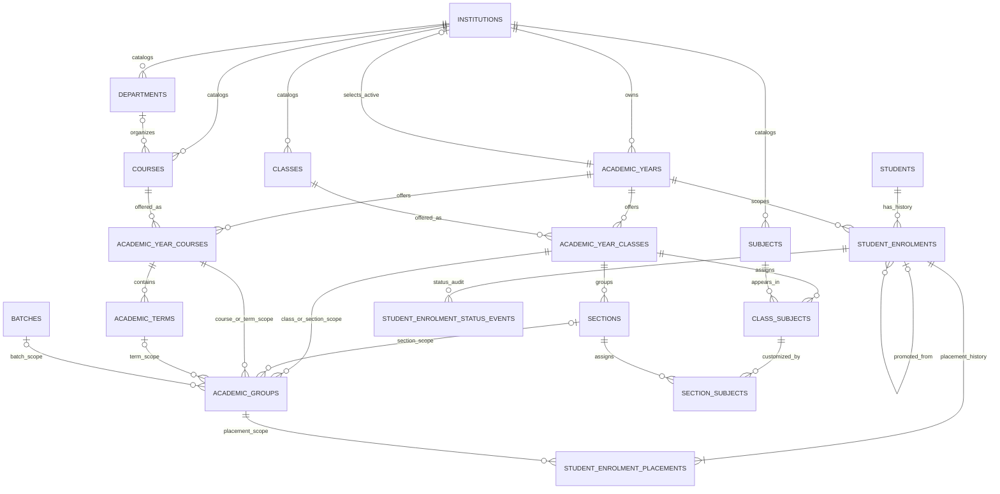
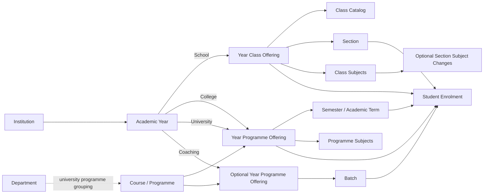
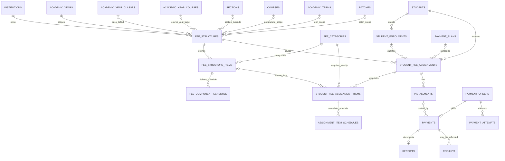
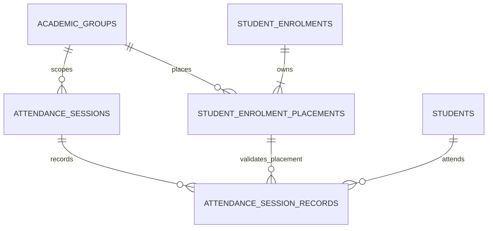
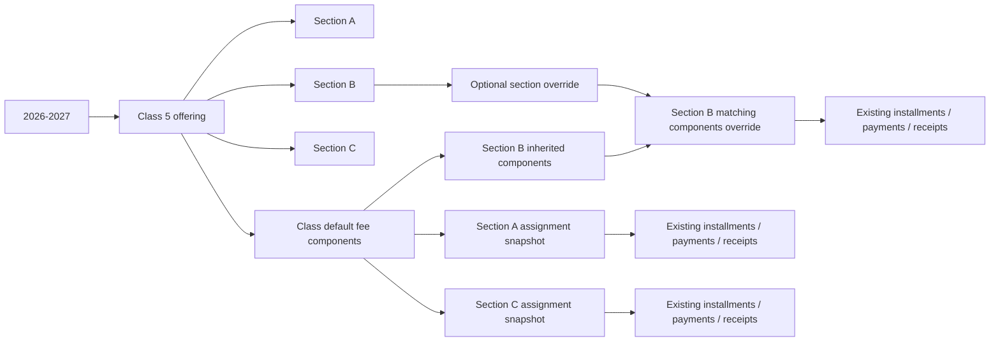

# Academic Relationship Diagrams

**Status:** Approved product rules and proposed technical design — documentation only.

## 1. Shared academic model

`ACADEMIC_YEAR_CLASSES` and `ACADEMIC_YEAR_COURSES` are offerings: they bind
reusable catalog records to a particular year. Sections belong to a class
offering. The unique enrolment key is
`(institution_id, academic_year_id, student_id)` and is not generated; it
applies to every status. Placement rows append the successive class/section or
course/term/batch scope for the year and retain a predecessor link, effective
time, reason, and actor. The diagram omits the repeated `institution_id` tenant
key present in every proposed tenant-owned relation. Composite tenant FKs are specified in
[ACADEMIC_DATABASE_DESIGN.md](./ACADEMIC_DATABASE_DESIGN.md).

## 2. Model-specific paths

## 3. Fee and settlement relationships

The final chain is existing payment and receipt architecture. Academic design
changes do not change these relationships. Existing assignments may retain a
NULL enrolment link for compatibility; every new assignment requires a
non-NULL link and the product-approved fee-eligible status. Composite FKs
enforce matching institution/student/year and matching institution/year/fee
structure. Whether `enrolled` as well as `active` is fee-eligible remains open.
Component snapshot identity is the existing fee category; source item/category
and source section references are tenant-scoped. The diagram does not show the
repeated composite-key columns. Historical fee components have unknown
frequency until explicitly configured; their cadence is not inferred.

## 4. Session attendance and compatibility

Each new attendance record references a session and a dated enrolment
placement. Composite FKs require the same institution, academic year, and
academic group on both references, plus the same student and enrolment on the
placement reference. School enrolments and sessions use a section group that
identifies both class and section, without requiring batches. College uses
course/term groups and coaching uses batch groups. A whole-class session
spanning multiple sections is not represented by one session under the exact
scope FKs; it requires an approved scope extension.

The existing `attendance_records` table remains the batch-based legacy source
and is not replaced or weakened during migration. It has no assumed FK to the
new session records; a verified backfill maps only unambiguous rows and leaves
the original record intact.

Fee structures include a target group code and effective period. Different
fee-purpose groups may coexist. For the same exact target/group, an indexed
guard row serializes writes while a transaction rejects overlapping active
periods; the range-exclusion rule is not represented as a simple unique key.

## 5. Example school fee inheritance

An override changes future snapshots only. No existing assignment or payment
history is recalculated.
